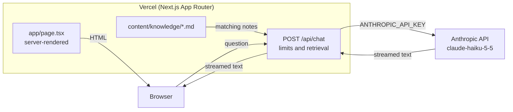

# Rob Walsh: Portfolio

Portfolio of Rob Walsh, a Senior Software Engineer in Dublin who builds backend and AI/LLM systems, with five years in financial services at Mastercard and J.P. Morgan. The page is a single server-rendered CV: hero, experience, selected work, skills and contact. **rob-gpt**, a small grounded assistant, answers questions about Rob from his notes. Live at [rob-walsh-homepage.vercel.app](https://rob-walsh-homepage.vercel.app).

<!-- Screenshot placeholder: add docs/screenshot.png and replace this comment with  -->

## Architecture



Page content lives in `app/profile.ts`. `/api/chat` applies per-IP limits, finds matching notes in `content/knowledge` with keyword search, and refuses questions the notes don't cover without calling the model. Answers show which notes they came from. The system prompt and API key stay on the server.

`npm run evals` scores rob-gpt against `evals/cases.json`, and `/evals` shows the results. Case studies are markdown files in `content/case-studies`.

## Tech choices

| Choice | Why |
|---|---|
| Next.js App Router, server-rendered page | Recruiters and crawlers get the full CV as HTML; the API key stays off the client |
| Anthropic SDK (`@anthropic-ai/sdk`) | Official client, streaming, typed errors |
| Claude Haiku 5.5, low effort | Short factual answers at the lowest cost per reply |
| Keyword retrieval over markdown | No vector database to run; refusals cost nothing |
| Plain CSS with custom properties | No UI framework to carry for one page |
| Vercel | Git-based deploys and preview builds for every branch |

## Local setup

Requires Node 20 or later.

```bash
npm install
cp .env.local.example .env.local   # add your ANTHROPIC_API_KEY
npm run dev
```

Open [http://localhost:3000](http://localhost:3000). Without a key, rob-gpt shows an "unavailable" message; the rest of the site still works.

| Variable | Required | Description |
|---|---|---|
| `ANTHROPIC_API_KEY` | For rob-gpt | Server-side only, read by `app/api/chat/route.ts` |

Get a key from the [Claude Console](https://console.anthropic.com/).

## Branches and deployment

- `master` is the GitHub default branch and the base for new work.
- Vercel's production branch is `main`. To release, fast-forward `main` to `master`, or switch the production branch to `master` in the Vercel project settings.
- Every other branch gets a Vercel preview.
