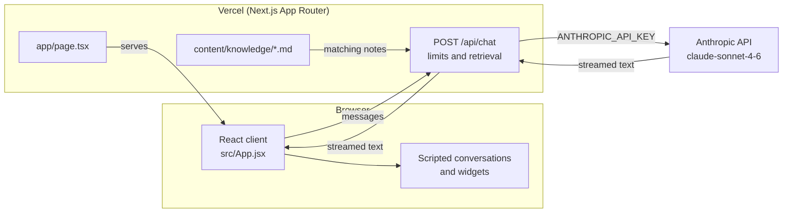

# Rob Walsh: Portfolio

Portfolio of Rob Walsh, a Senior Software Engineer in Dublin who builds backend and AI/LLM systems, with five years in financial services at Mastercard and J.P. Morgan. Instead of a static CV page, the site opens as a conversation with **rob-gpt**: scripted threads cover the common questions instantly, and anything else goes to Claude through a server-side route. Live at [rob-walsh-homepage.vercel.app](https://rob-walsh-homepage.vercel.app).

<!-- Screenshot placeholder: add docs/screenshot.png and replace this comment with  -->

## Architecture



The chat is a client component. `/api/chat` applies per-IP limits, finds matching notes in `content/knowledge` with keyword search, and refuses questions the notes don't cover without calling the model. Answers show which notes they came from. The system prompt and API key stay on the server.

`npm run evals` scores rob-gpt against `evals/cases.json`, and `/evals` shows the results. Case studies are markdown files in `content/case-studies`.

## Tech choices

| Choice | Why |
|---|---|
| Next.js App Router | A route handler keeps the API key off the client, without running a separate backend |
| Vercel AI SDK (`ai`, `@ai-sdk/anthropic`) | Handles streaming from Claude in a few lines |
| Claude Sonnet, 400 max tokens | Keeps answers short and bounds the cost of each reply |
| Scripted threads before live calls | Common questions answer instantly and cost nothing |
| Plain CSS with custom properties | No UI framework to carry for one page |
| Vercel | Git-based deploys and preview builds for every branch |

## Local setup

Requires Node 20 or later.

```bash
npm install
cp .env.local.example .env.local   # add your ANTHROPIC_API_KEY
npm run dev
```

Open [http://localhost:3000](http://localhost:3000). Without a key, live chat fails; the rest of the site still works.

| Variable | Required | Description |
|---|---|---|
| `ANTHROPIC_API_KEY` | For live chat | Server-side only, read by `app/api/chat/route.ts` |

Get a key from the [Claude Console](https://console.anthropic.com/).

## Branches and deployment

- `master` is the GitHub default branch and the base for new work.
- `main` is the branch Vercel last deployed to production (commit `c38fcdc`). A push to `master` builds a preview, not a production release.
- Every other branch gets a Vercel preview.

To release, either update `main` from `master`, or change the production branch to `master` in the Vercel project settings and retire `main`.
